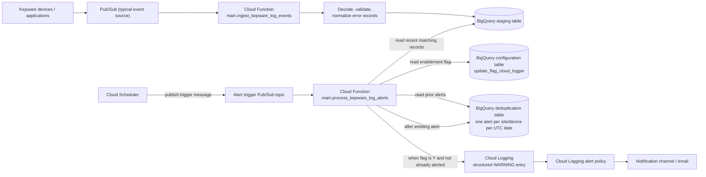

# Kepware Log Ingestion and Alerting

## What this workflow does

This project collects Kepware log records, keeps records containing selected
error patterns in a BigQuery staging table, and can emit a warning to Cloud
Logging for affected site/device pairs. A separate deduplication table is used
to avoid sending another alert for the same pair on the same UTC date.

The workflow has two separately invoked Cloud Function entry points:

1. **Ingestion** receives Kepware records (typically from Pub/Sub), normalizes
   matching records, and inserts them into BigQuery.
2. **Alert processing** is invoked separately (typically by a scheduler), reads
   recent staged records, and emits structured Cloud Logging entries when its
   configuration flag is enabled.

Ingestion does not itself send alerts, and alert processing does not ingest
records. The code creates log entries; alert policies, notifications, and email
delivery must be configured in Google Cloud outside this repository.

## Architecture diagram



Ingestion and alert processing are separate invocations. The diagram shows
Pub/Sub and a scheduler as typical triggers; the actual topics and schedule are
deployment configuration, not created by this code. Since the alert handler
uses an event-style `(data, context)` signature, a typical scheduled setup is
for Cloud Scheduler to publish a message to a Pub/Sub topic that triggers the
alert function.

## Quick walkthrough with an example

Imagine a device at `SITE-17` logs `Device Not Responding`.

1. **The producer publishes a message.** A Kepware-side producer or another
   configured service publishes this JSON to the configured Pub/Sub topic:

   ```json
   {
     "site_id": "SITE-17",
     "device_name": "PLC-04",
     "timestamp": "2026-11-17T09:10:00Z",
     "severity": "ERROR",
     "message": "Device Not Responding"
   }
   ```

   Pub/Sub does not get this message from either Cloud Function in this
   workflow; it is the input transport. Pub/Sub wraps the published bytes in
   its event payload (usually base64-encoded in the `data` field).

2. **Pub/Sub triggers the ingestion Cloud Function.** The function is deployed
   with `main.ingest_kepware_log_events` as its entry point and configured to
   subscribe to that topic. When a message arrives, Google Cloud invokes this
   function with the Pub/Sub event. The function decodes the event, recognizes
   `DEVICE_NOT_RESPONDING`, normalizes the record, and inserts it into the
   BigQuery staging table. A simplified staged row looks like:

   ```json
   {
     "site_id": "SITE-17",
     "device_name": "PLC-04",
     "log_level": "ERROR",
     "log_message": "Device Not Responding",
     "error_codes": ["DEVICE_NOT_RESPONDING"],
     "error_count": 1,
     "log_timestamp_utc": "2026-11-17T09:10:00Z"
   }
   ```

   This function does not publish a second message to Pub/Sub and does not
   send an alert. Its output is the inserted BigQuery row.

3. **A separate schedule triggers the alert Cloud Function.** For example,
   configure a Cloud Scheduler job to publish a small trigger message to a
   dedicated Pub/Sub topic, then configure the alert Cloud Function to be
   triggered by that topic with `main.process_kepware_log_alerts` as its entry
   point. Each scheduled publication causes Google Cloud to invoke the
   function. This is separate from the ingestion topic and is not an automatic
   call from the ingestion function. The alert function reads the configured
   lookback window (15 minutes by default), queries recent staging rows, reads
   the `update_flag_cloud_logger` setting, and checks whether `SITE-17` /
   `PLC-04` already has an alert recorded for today's UTC date.

4. **The alert function writes the alert and records deduplication.** If the
   flag is `Y` and that site/device pair has not already been alerted today,
   the function writes a structured `WARNING` entry to Cloud Logging, similar
   to:

   ```json
   {
     "key": "ALERT_KEPWARE_LOG_ERRORS",
     "site_id": "SITE-17",
     "device_name": "PLC-04",
     "error_codes": ["DEVICE_NOT_RESPONDING"],
     "error_count": 1,
     "detection_window": "Last 15 MINUTE",
     "details": "2026-11-17 09:10:00 UTC;ERROR;kepware;Device Not Responding"
   }
   ```

   It then inserts a row for `SITE-17` / `PLC-04` into the BigQuery
   deduplication table. A separately configured Cloud Logging alert policy
   can match the log entry and send a notification. If the flag is not `Y`,
   no log entry or deduplication row is written. If the pair was already
   alerted today, the duplicate alert is skipped.

## Project layout

```text
main.py                         Cloud Function entry-point wrappers
functions/
  __init__.py                   Python package marker
  kepware_alerts.py             Ingestion, normalization, and alert logic
requirements.txt                Google Cloud client dependencies
```

`main.py` is intentionally small. It exposes functions that can be selected as
Cloud Function entry points and forwards work to the implementation in
`functions/kepware_alerts.py`.

## End-to-end flow

### 1. Ingest logs into BigQuery

Configure the ingestion Cloud Function to use
`main.ingest_kepware_log_events` as its entry point and connect the appropriate
event source, commonly a Pub/Sub topic.

1. The handler creates a BigQuery client.
2. `decode_pubsub_message` decodes the event's `data` field when present. String
   data is treated as base64-encoded UTF-8. Decoded JSON is returned as its
   parsed value; non-JSON text is wrapped as `{"message": text}`.
3. The handler accepts a list of records, an object with a list-valued
   `records` field, or a single record.
4. `normalize_log_record` extracts a message and checks it for supported
   patterns. Non-dictionaries, empty messages, and messages without a
   recognized pattern are skipped.
5. Matching records are normalized and inserted into the staging table with
   `insert_rows_json`.
6. If there are no matching records, the function returns a success message
   without inserting. If BigQuery reports insert errors, it raises a
   `RuntimeError`.

### 2. Scan recent staged logs and alert

Configure a separate event-triggered Cloud Function using
`main.process_kepware_log_alerts` as its entry point. A Cloud Scheduler job
can publish a trigger message to the function's Pub/Sub topic on the desired
cadence.

1. The handler creates BigQuery and Cloud Logging clients and reads the alert
   window from environment variables.
2. `_read_flag_value` reads `update_flag_cloud_logger` from the configuration
   table for `log_name = 'alert_kepware_log_errors'`. Only a value of `Y`
   enables Cloud Logging writes. If the query fails or returns no row, the
   flag defaults to `N`.
3. `_read_recent_stage_rows` queries the staging table for records whose
   `log_timestamp_utc` is within the configured window. It checks the message
   text again for supported patterns and builds normalized result rows.
4. `_read_alerted_sites` reads site/device pairs already present in the
   deduplication table for the current UTC date.
5. The alert handler groups the recent records by `(site_id, device_name)` and
   excludes pairs already alerted today.
6. If logging is enabled, it writes one structured `WARNING` log entry per
   remaining pair. The entry includes the site, device, unique error codes,
   count of matching records, detection window, date, and up to 50 detail
   lines.
7. After emitting entries, it inserts corresponding rows into the
   deduplication table. Dedup insert errors are printed as warnings; they do
   not change the final `"success"` return.

If there are no recent errors or all affected pairs were already alerted that
day, processing returns `"success"` without emitting a new entry. If the
configuration flag is not `Y`, the function skips Cloud Logging and does not
write deduplication rows.

## Recognized log patterns

Patterns are case-insensitive and are defined in `ERROR_PATTERNS`:

| Normalized code | Pattern recognized |
| --- | --- |
| `OX4` | `0x4` with optional extra zeroes, or `ox4` |
| `OX1` | `0x1` with optional extra zeroes, or `ox1` |
| `DEVICE_NOT_RESPONDING` | `device not responding`, with whitespace between words |

The normalized error-code names are what get stored in staging records and
included in alert entries. A record is only staged when its message matches at
least one of these patterns.

## Input and normalized record fields

The decoder can receive a JSON object, a list of objects, an object containing a
`records` list, or plain text. For an individual record, these input aliases
are used:

| Normalized field | Accepted input fields (first non-empty value is used) |
| --- | --- |
| Message | `message`, `log_message`, `details`, `raw_log` |
| Site | `site_id`, `site` |
| Device name | `device_name`, `device`, `asset_id`, `point_name` |
| Timestamp | `log_timestamp_utc`, `timestamp`, `event_time`, `created_at`, `time` |
| Source system | `source_system`, `system` |
| Log source | `log_source`, `source` |
| Asset ID | `asset_id`, `device_id` |
| Log level | `severity`, `log_level`, `level` |

The staging record contains `source_system`, `log_source`, `site_id`,
`asset_id`, `device_name`, `log_level`, `log_message`, `error_codes`,
`error_count`, `log_timestamp_utc`, and `created_at`. Missing site/device
identifiers use `UNKNOWN`; missing source and level fields use defaults. Log
messages are limited to 15,000 characters. Timestamps are converted to UTC
when parseable; when absent or invalid, the current UTC time is used.

## Functions

All implementation functions are in `functions/kepware_alerts.py`.

### Entry-point wrappers in `main.py`

| Function | Purpose |
| --- | --- |
| `ingest_kepware_log_events(event, context=None)` | Cloud Function entry point for ingestion; forwards to the implementation function with the same name. |
| `process_kepware_log_alerts(data, context=None)` | Cloud Function entry point for scheduled alert processing; forwards to the implementation function with the same name. |

The `context` arguments are accepted for Cloud Function compatibility and are
not otherwise used by the implementation.

### Helpers and processing functions

| Function | Purpose |
| --- | --- |
| `_utc_now()` | Gets the current timezone-aware UTC datetime. |
| `_safe_int(value, default)` | Converts a value to a positive integer or returns a fallback. It is currently defined but not called by the workflow. |
| `_parse_timestamp(raw_value)` | Parses supported datetime, Unix timestamp, ISO, and common SQL timestamp values into UTC. Returns `None` when parsing fails. |
| `detect_error_patterns(log_message)` | Returns the normalized error codes found in the supplied text. |
| `_get_site_device(raw_record)` | Extracts site and device identifiers, supplying `UNKNOWN` when missing. |
| `normalize_log_record(raw_record)` | Converts a matching raw record into a staging-table row, or returns `None` for an invalid/non-matching record. |
| `decode_pubsub_message(event)` | Decodes Pub/Sub-style base64 event data and parses JSON where possible. |
| `ingest_kepware_log_events(event, context=None)` | Decodes, normalizes, filters, and inserts matching records into BigQuery. |
| `_get_alert_window()` | Reads and validates the alert time interval and unit from environment variables. |
| `_read_flag_value(client_bq)` | Reads the Cloud Logging enablement flag; defaults to `N` on query failure or missing rows. |
| `_read_recent_stage_rows(client_bq, time_parameter, time_pattern)` | Queries the staging table for recent rows and retains messages matching configured errors. |
| `_read_alerted_sites(client_bq)` | Reads today's UTC site/device pairs from the deduplication table. |
| `detect_kepware_alerts(data, context=None)` | Groups recent errors, skips pairs already alerted today, emits Cloud Logging entries if enabled, and writes deduplication rows. |
| `process_kepware_log_alerts(data, context=None)` | Implementation-level wrapper that calls `detect_kepware_alerts`; `main.py` exposes this one alert-processing entry point. |

## Configuration

The table and logger names can be overridden with environment variables:

| Environment variable | Default |
| --- | --- |
| `KEPWARE_STAGE_TABLE` | `fxg_pdm_us_de_stg.tbl_stg_kepware_log_records` |
| `KEPWARE_DEDUP_TABLE` | `fxg_pdm_us_de_logs.tbl_kepware_log_alert_sent` |
| `KEPWARE_CONFIG_TABLE` | `fxg_pdm_us_de_logs.tbl_update_flag_shm_cloud_logger` |
| `KEPWARE_LOGGER_NAME` | `ALERT_KEPWARE_LOG_ERRORS` |
| `time_parameter` | `15` |
| `time_pattern` | `MINUTE` |

`time_parameter` must be a positive integer. `time_pattern` must be `MINUTE` or
`HOUR` (case-insensitive). Invalid values fall back to 15 minutes. The
environment variable names are case-sensitive on many deployment platforms;
use the spellings shown in the table.

### Schedule cadence vs. detection window

These are two different settings:

- **Schedule cadence** is how often Cloud Scheduler publishes to the alert
  trigger topic. It is not set in this Python code; it must be configured in
  Google Cloud. For example, a cron schedule of `*/5 * * * *` publishes every
  five minutes.
- **Detection window** is how far back the alert function looks in the staging
  table. It is configured by `time_parameter` and `time_pattern`, which
  default to 15 minutes. It is independent of the Scheduler cadence.

For example, with a five-minute schedule and the default 15-minute window,
each run scans the most recent 15 minutes, so adjacent runs intentionally
overlap. The code deduplicates by site/device pair for the whole UTC date, so
after a pair is alerted once, later runs that day skip that pair even if new
matching rows arrive. Choose the schedule and window for the desired detection
latency and coverage; neither the example five-minute cadence nor any schedule
is provisioned by this repository.

The deployment environment also needs Google Cloud credentials and permissions
appropriate for the operations this code performs: querying and inserting into
the configured BigQuery tables, and writing Cloud Logging entries when
alerting is enabled.

## Operational notes

- The alert window uses `log_timestamp_utc`, not `created_at`.
- Deduplication is by site/device pair and UTC date, not by individual error
  code.
- The alert query and deduplication query are separate from the ingestion
  invocation; schedule/trigger both functions according to the desired
  ingestion and alert cadence.
- BigQuery configuration-query failures disable alert output for that run by
  returning the default flag `N`.
- Deduplication query failures are treated as no pairs previously alerted,
  which can allow a repeated alert.
- Cloud Logging entries only trigger notifications if an appropriate Cloud
  Logging alert policy and notification channel are configured separately.
